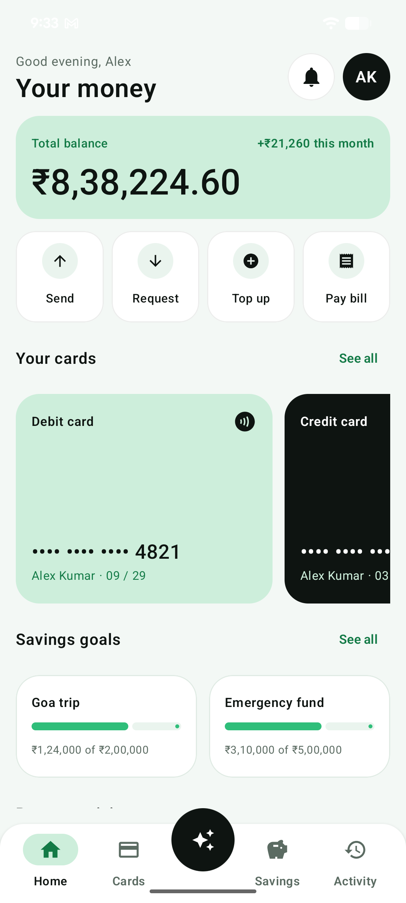
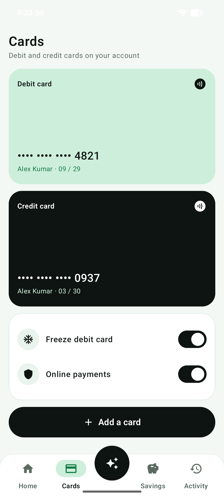
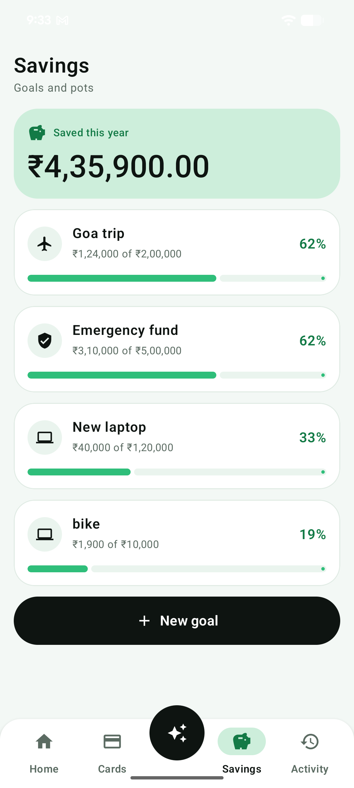
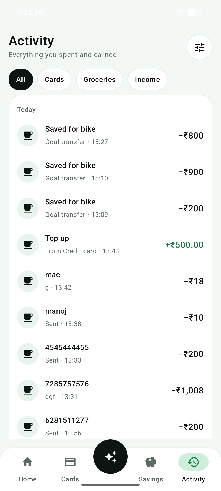

# Quillo

Quillo is a personal banking and money-tracking app for Android. It is built with Jetpack Compose and Firebase, and it includes a Razorpay test checkout for bill payments and a chat assistant that answers questions about your money and prepares actions for you to confirm.

This is a personal project. All payments run in Razorpay **test mode**. No real money moves.

## Screenshots

| Home | Cards | Savings | Activity |
|---|---|---|---|
|  |  |  |  |

## What the app does

1. **Sign in.** Email and password through Firebase Auth. The password field has an eye icon to show or hide the text.
2. **Intro screen.** Shown once per install. The "seen" flag is stored only on the device and is excluded from Android backup, so reinstalling the app shows the intro again.
3. **Home.** Total balance, this month's change, quick actions (Send, Request, Top up, Pay bill), your cards and savings goals, and recent activity.
4. **Send money.** Sends money to a person. Saved to your transactions in Firestore. Shows a confirmation sheet first, then a processing screen and a success or failed screen.
5. **Request money.** Creates a money request from someone else.
6. **Top up.** Adds money from a saved card through Razorpay **test** checkout. The app records the top-up only after Razorpay reports success.
7. **Pay bill.** Pays a bill through Razorpay **test** checkout. The bill is marked paid only after the payment succeeds.
8. **Cards.** Lists debit and credit cards. Choose a card from a bottom sheet. Swipe a card to delete it.
9. **Savings goals.** Create a goal with a target. Tap a goal card to open the Add money sheet, which moves money from your balance into the goal.
10. **Activity.** Full list of transactions.
11. **Ask Quillo.** A chat assistant. It answers questions about your balance, cards, goals, bills and transactions, and it can prepare send, pay-bill and add-to-goal actions. Nothing is paid or sent until you reply "yes". It talks to the Quillo agent server (see the agent repository).
12. **Biometric lock.** Optional fingerprint or face unlock, asked once.

## Tech stack

- Kotlin, Jetpack Compose, Material 3, Navigation Compose
- Firebase Auth (email and password) and Cloud Firestore
- Razorpay Android Checkout 1.6.33 (test mode)
- `kotlinx-coroutines-play-services` for `await()` on Firebase calls
- BiometricPrompt
- Plain `HttpURLConnection` for calls to the agent server (no extra HTTP library)

## Project structure

```
app/src/main/java/com/inouiw/quillo/
  MainActivity.kt              Hosts the app and forwards Razorpay results
  data/
    AppData.kt                 Reads and writes the user's Firestore data
    AgentApi.kt                Calls the agent server from the Ask screen
    RazorpayCheckout.kt        Opens Razorpay test checkout and delivers the result
    AppPrefs.kt                Device-only flags (intro seen, biometric choices)
    Models.kt                  Data classes (Goal, Card, Transaction, ...)
  ui/
    QuilloApp.kt               Navigation and the login gate
    screens/                   One file per area (Home, Money, Savings, Ask, Payments, ...)
    components/                Shared UI pieces (SwipeToDelete, ScreenTitle, ...)
    theme/                     Colours, type and shapes
app/src/main/res/
  xml/data_extraction_rules.xml  Keeps the device-only prefs out of backup
  xml/backup_rules.xml           Same, for older Android versions
  xml/network_security_config.xml Allows plain HTTP to the agent server's address only
```

## Data model in Firestore

All data sits under `users/{uid}`, one owner per user:

| Path | What it holds |
|---|---|
| `summary/main` | Balance, available to spend, saved this year, next bill |
| `profile/main`, `settings/main` | Profile and settings |
| `cards/*` | Debit and credit cards (number is masked, `frozen` flag) |
| `goals/*` | Savings goals (`name`, `saved`, `target`, `order`) |
| `transactions/*` | Every money movement, newest first |
| `bills/*` | Bills (`name`, `amount`, `paid`, `order`) |
| `notifications/*`, `requests/*` | Notifications and money requests |
| `agent/config` | The token the Ask screen uses to call the agent server |

Firestore security rules are owner-only: a signed-in user can read and write only their own `users/{uid}` data. The rules are currently in **test mode**, which expires on **31 December 2026**. Replace them with production rules before then.

## Setup from scratch

1. **Create a Firebase project** and add an Android app with package name `com.inouiw.quillo`.
2. **Download `google-services.json`** into `app/`. It is git-ignored on purpose, so you must add your own.
3. **Enable Email/Password** sign-in in Firebase Authentication.
4. **Create a Firestore database** and set the rules described above.
5. **Razorpay test keys.** Put the test key ID in `app/src/main/res/values/strings.xml` as `razorpay_key_id` (it starts with `rzp_test_`). The app must never hold the key secret. Only the agent server uses the secret.
6. **Agent server address.** The Ask screen calls `BASE_URL` in `data/AgentApi.kt`. It is set to the developer's Mac on the home Wi-Fi (`http://192.168.29.213:8787`). Change it to your machine's address if it differs. The phone and the machine must be on the same network.
7. **Build and run** in Android Studio, or from the terminal:

   ```bash
   ./gradlew :app:assembleDebug
   adb install -r app/build/outputs/apk/debug/app-debug.apk
   ```

## Security notes

- The app holds no secret keys. It holds only the Razorpay test key ID.
- The agent token is stored in the user's own Firestore data and read after sign-in. It is not compiled into the APK.
- The agent server is reachable only on the home network, over plain HTTP. Do not expose it to the internet as it is.
- Payments: Razorpay test mode only. The app refuses to run payment links with a live key on the agent side.

## Status and known limits

- Testing so far was on a Pixel 8a over wireless ADB.
- The Ask screen works only while the agent server is running on the Mac.
- A Razorpay payment is confirmed when the agent checks the link. Razorpay does not push the result into the app, so there is no live "payment done" message.
- Test-mode Firestore rules expire on 31 December 2026.
